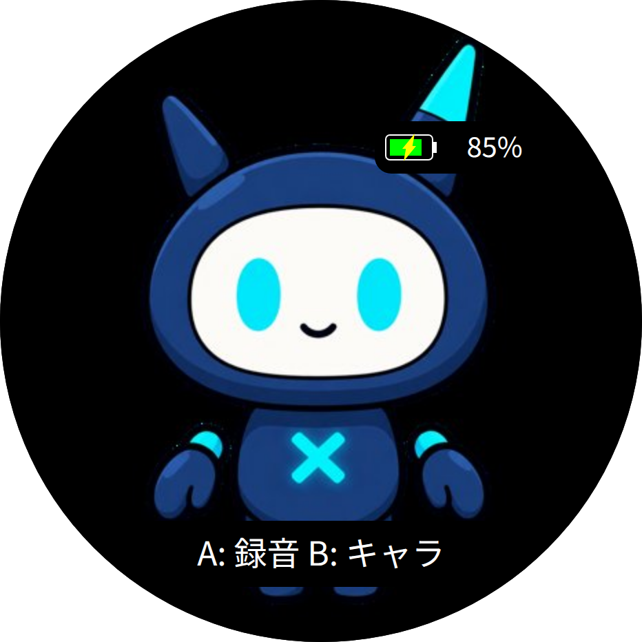
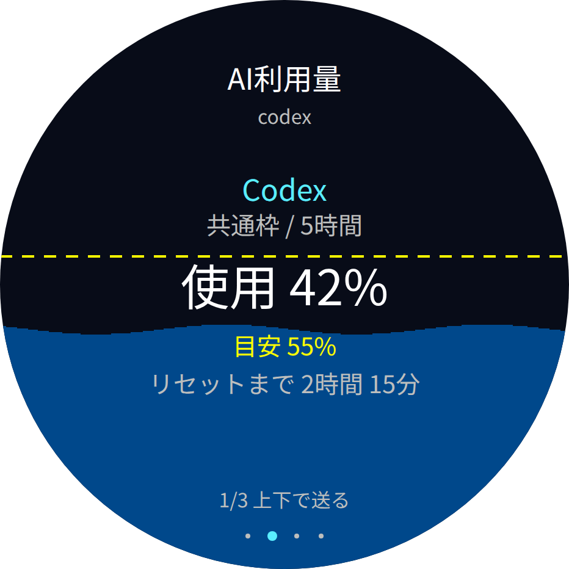

# xangi-stopwatch

M5Stack StopWatchのマイク・画面・スピーカーで会話する[xangi](https://github.com/karaage0703/xangi)の拡張機能です。キャラの切替や、USB・Tailscale経由の接続に対応します。

  
  

描画コードから生成した画面イメージです。詳しい表示・操作は[使い方](docs/usage.md)をご覧ください。

## はじめに

利用には、M5Stack StopWatch本体と、AIエージェントを設定済みのxangiが必要です。xangiはPC・サーバー側で動作し、StopWatchを会話用の端末として接続します。

1. **xangi本体をセットアップする** — [xangiのQuickstart](https://github.com/karaage0703/xangi#quickstart)に従ってインストールし、`xangi setup`でAIバックエンドとWeb Chatを使える状態にします。導入済みなら次へ進みます。
2. **Web UIの「拡張」を開く** — 一覧の **xangi-stopwatch** で「追加」を選びます。一覧にない場合は、リポジトリURL `https://github.com/karaage0703/xangi-stopwatch` を指定して追加します。
3. **セットアップ会話を進める** — 開いた専用会話でAIがこのリポジトリの手順を読み、ファームウェアの書き込み、USBまたはTailscaleの接続設定、音声サービスの準備を案内します。初めて試す場合はUSB接続から始めます。ファームを書き込むと、本体で使っていたアプリは置き換わります。
4. **会話を試す** — 「拡張」→「xangi-stopwatch」→「開く」でAgent・声・顔を設定して保存します。本体のAボタンで録音し、もう一度Aを押すと送信します。

導入途中から再開する場合は、拡張一覧の「セットアップ」で専用会話を開きます。接続できただけでなく、録音・返答の音声再生まで確認すると準備完了です。

## ドキュメント

- [セットアップ詳細（AI・手動導入向け）](XANGI_SETUP.md)
- [使い方](docs/usage.md) — 会話・キャラ・表示・利用量・タスク・Wi-Fi設定
- [通信仕様](docs/protocol.md) / [ファームウェア](firmware/README.md)

## License

MIT
