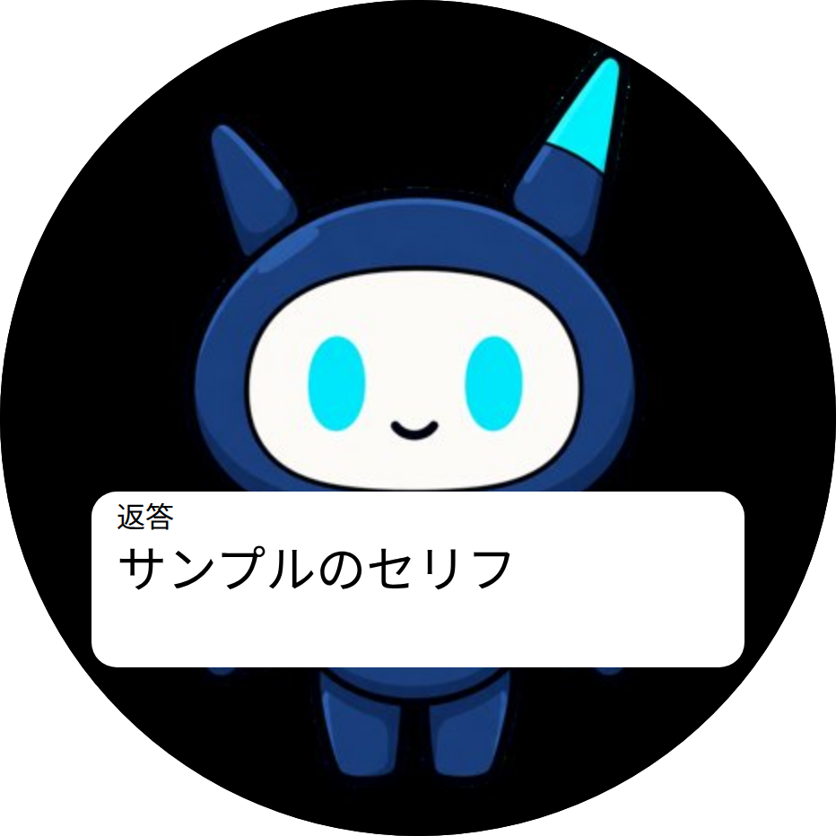
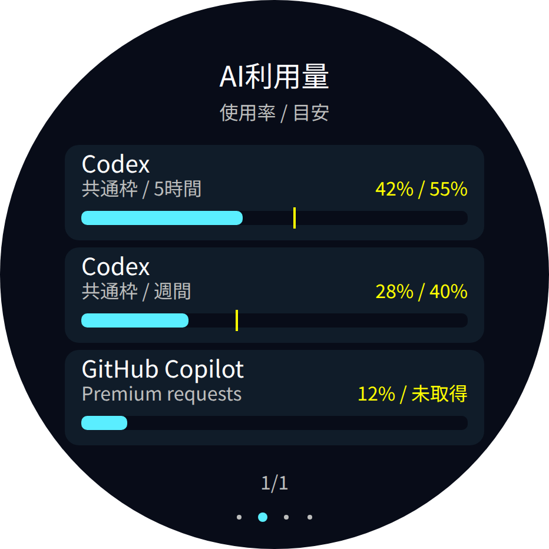
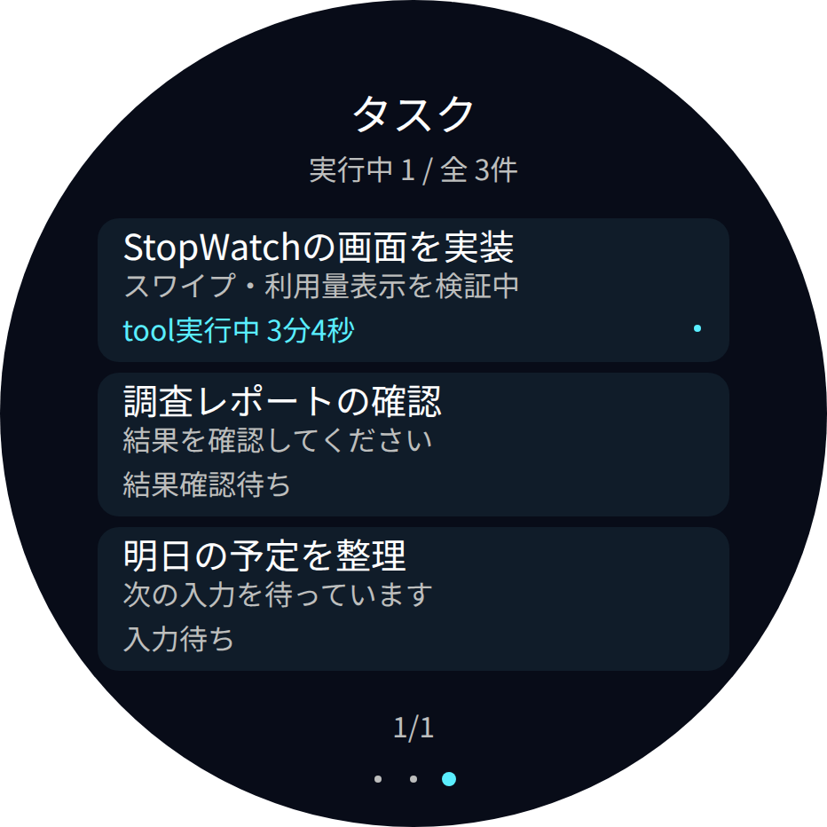

# 使い方

StopWatchのマイク・466×466円形画面・スピーカーで会話します。画像・口パク・音声再生に対応し、Agent・声・キャラの設定はStopWatch専用です。

`StopWatch ↔ USB / Tailnet ↔ xangi-stopwatch ↔ xangi本体・共通Whisper・VOICEVOX/Piper`

## 最初の準備

まず[READMEの導入手順](../README.md#はじめに)に従って、[xangi本体](https://github.com/karaage0703/xangi)をセットアップします。導入済みなら、Web UIの「拡張」→「xangi-stopwatch」→「追加」から専用のセットアップ会話を開いてください。

AIの案内に沿って専用ファーム、接続設定、音声サービスを準備します。初めて試す場合はUSB接続を使います。ファームを書き込むと、それまで本体で使っていたアプリは置き換わります。手動導入や設定項目の確認には[セットアップ詳細](../XANGI_SETUP.md)を参照してください。

「拡張」→「xangi-stopwatch」→「開く」でAgent・声・顔を設定して保存します。Aで録音、もう一度Aで送信、録音中のBで取消、録音中以外のBで次のキャラへ切り替えます。

## 本体の表示と操作

電池残量は右上に緑のバーとパーセントで表示し、充電中は黄色のマークを重ねます。設定画面の「本体の表示」から右上・左上・上中央・非表示を選択できます。画面のタップで操作案内・電池と充電表示を表示・非表示に切り替えます。会話のセリフ（字幕）は、文字非表示にしても表示します。どちらの設定も本体に保存され、電源を入れ直しても保持します。起動中の接続状況は常に表示します。

Aボタンで録音開始・送信、Bボタンで録音や返答を停止します。待機中のBボタンはキャラ切り替えです。

## 設定画面からxangiホームへ戻る

xangiから開いた設定画面では、左上の家アイコン付き「xangiホーム」ボタンから同じ環境のホームへ戻れます。ボタンの見た目はxangi-searchと共通です。拡張サーバーへ直接アクセスした場合は、xangiのURLを判断できないため表示しません。画面と拡張一覧での正式名称は`xangi-stopwatch`です。

## 音量を変える

**xangi本体の「拡張」→「xangi-stopwatch」→「開く」**から設定画面へ進みます。

スライダーで音量を選び「保存」を押します。初期値は25、最大255、0で消音です。保存した音量は本体の再起動後も保持されます。設定には端末の接続が必要です。

画面の直接パスは `/api/extensions/xangi-stopwatch/ui` です。利用中のxangi本体URLに続けて開いてください。

## 停止

本体のBは録音中だけ録音を取り消します。録音中以外は次のキャラへ切り替え、処理中の返答は打ち切ります。保存キャラが1件なら切り替えません。端末との通信も停止する場合は、xangiの拡張管理からStopWatch拡張を停止します。

## 困ったとき

- **接続できない**: 拡張の起動状態と、設定したUSBポートを確認します。シリアルモニター等が同じポートを開いている場合は閉じます。
- **音が出ない**: 音量が0でないこと、PiperまたはVOICEVOXを選んでいること、本体ボタンで停止していないことを確認します。
- **設定画面が古い**: ページを再読み込みします。拡張更新後は拡張の再起動も必要です。

## 無線接続

Tailnet版ファームと、専用ポート・登録したpeerの設定が必要です。手順は[セットアップ](../XANGI_SETUP.md#tailnet)と[ファームの説明](../firmware/README.md)を参照してください。USB版のままケーブルを外しても無線へ切り替わりません。

初回接続ではWi-Fi接続後に時刻同期とTailnet登録を待ちます。Tailnet版の`NET_STATUS`コマンドで、Wi-Fi状態・IP取得の有無・時刻同期の完了を確認できます。認証キーやパスワードは返しません。

## 開発時の確認

```bash
uv sync --locked --dev
uv run --locked ruff check src tests scripts
uv run --locked ruff format --check src tests scripts
uv run --locked pytest -q
```

同じチェックをGitHub Actionsで実行します。実機・秘密設定を使わず、模擬端末で検証します。ファームのビルド・書き込みはCIの対象外です。

Pythonの上限値・時間間隔は `src/xangi_stopwatch/constants.py` にまとめています。画像寸法やペイロード上限などの通信仕様を変える場合は、ファームと[通信仕様](protocol.md)も合わせて変更してください。接続先は定数を書き換えず `config.json` で設定します。

## 本体マイクでの単独会話

[セットアップ](../XANGI_SETUP.md#本体マイクで単独会話)で接続と会話設定を準備します。

- Aを押すと録音開始。話し終わったらもう一度Aを押して送信します。
- 録音中のBは取消、それ以外のBは次のキャラへの切替です。切替前の返答は再生しません。
- 無音になっても自動送信しません。30秒の上限に達すると録音を破棄します。
- 顔の画面を保ち、下部に24pxのゴシック体で「A: 録音 B: キャラ」「A: 送信 B: 停止」「送信・返答待ち」を表示します。画面全体は切り替えません。
- 認識・会話処理中はAで次の録音を始められません。返答後に次の会話を開始できます。
- 音量設定画面には単独会話の処理状態と直近のエラーを表示します。

録音は本体のメモリ上に保持し、送信するとサーバーの音声認識に渡します。認識したテキストと返答はxangiの会話履歴に残ります。録音中と再生中はマイク・スピーカーを切り替えて使います。

診断用の`/api/settings`の`conversationTimings`で、直近会話の録音転送・音声認識・Agent・音声合成・全体の秒数を確認できます。録音転送は対応ファームでBase64・最大32KB単位を使います。未対応ならhex・最大16KB、上限通知のない旧ファームでは1KB単位を使います。

## StopWatch専用の会話設定

xangiの「拡張」→「xangi-stopwatch」→「開く」から設定画面へ進みます。Agentはxangi本体の一覧から選び、言語・読み上げ方式・VOICEVOXの声・顔を保存します。顔は選択したAgentのワークスペースの `assets/xangi-avatar/closed.png` と `assets/xangi-avatar/open.png` から読み込みます。この2つを初期値として、キャラごとにワークスペース相対パスを入力・保存できます。「画像を確認」で両方をプレビューできます。画像がない・壊れているなど読み込めない場合は、口の開閉両方を同梱の標準xangiアバターに切り替え、プレビューにも代替画像であることを表示します。保存すると会話セッションを切り替えるため、録音・返答中は保存できません。会話設定はサーバーに保存されます。音量は本体に保存され、別の保存ボタンで変更します。

xangi本体と共通音声サービス、選択した音声エンジンは必要です。共通音声サービスの手順は[セットアップ](../XANGI_SETUP.md#共通音声サービス)を参照してください。

標準アバター画像と共通音声workerはxangi-avatar（MIT、Copyright 2026 karaage）から取り込み、同じMITライセンスで配布しています。重み・音声エンジンは含みません。

### 音声テストと会話の表示

- 「音声テスト」は保存前の声・読み上げ方式を確認できます。音は設定画面を開いている端末から、小さめの音量で再生します。「テスト音声を停止」で準備中・再生中とも中止できます。本体の音量は別の音量設定で変えます。
- 本体では顔を残し、認識した言葉と返答を日本語ゴシック体の吹き出しで表示します。長文は2行ずつページを切り替えます。認識結果は最大1,000文字、返答は読み上げるまとまりごとに表示します。
- 設定画面では直近の認識結果・返答の全文と処理状態を確認できます。2秒ごとに更新し、次の発話の処理開始時に表示を入れ替えます。

返答は途中テキストの文末、または最大80文字（読点・空白などの区切りを優先）ごとに音声合成し、全文完成を待たず読み上げます。再生中に続きの音声を最大2件まで先行生成します。途中テキストを返さないAgentでは全文完成後に開始します。`conversationTimings.first_audio`は録音転送開始から最初の再生受付までの秒数です。`agent`は返答ストリームを待った時間の合計で、音声合成・再生との並行処理を含むため全体時間への単純加算はできません。

吹き出しの「返答 1文目、2文目…」は読み上げる文の順番です。長い文には別にページ番号を表示します。字幕のページ切替は音声データの転送完了後に開始します。返答が終わると本体の吹き出しは消えますが、設定画面では直近の全文を確認できます。

### 共通音声サービスのGPU設定

`XANGI_WHISPER_DEVICE=auto` はCTranslate2、PyTorchの順にCUDA対応を調べます。
CTranslate2がCPU専用の場合は、CUDA対応のPyTorchと`openai-whisper`が入ったPythonで
`src/xangi_stopwatch/voice_worker.py`を起動してください。
`XANGI_WHISPER_DEVICE=cuda`を指定するとGPUが使えない場合はエラーになります。
モデルは`XANGI_WHISPER_MODEL`（既定`medium`）で指定します。
`GET /health`の`whisperLoaded`・`whisperBackend`・`whisperDevice`で読込後の状態を確認できます。
Avatarの`AVATAR_VOICE_URL`とStackchanの`voice_url`を同じサービスへ向けるとモデルを共有できます。

## キャラの保存と切替

「使用・編集するキャラ」で対象を選び、「このキャラで会話するAgent」を変更して「このキャラを保存」を押します。Agent・言語・声はキャラごとに保存されます。顔は選択したAgentのワークスペースから読み込みます。同じAgentを複数のキャラで使うこともできます。Agentを変更すると、新しいAgentのワークスペースにある指定パスの画像を使います。

別のキャラを作る場合は「複製して追加」で現在の保存済みキャラを複製し、名前・Agent・言語・声を変更して保存します。最大20件です。既存の設定は「キャラ1」として引き継ぎます。音量・接続先・共通音声サービスは端末全体で共有します。

「使用・編集するキャラ」の選択、または本体のBで切り替えます。本体のBは保存順に循環します。切替時は新しい会話セッションを開始し、選択は再起動後も保持します。設定画面も本体側の切替に追従します。最後の1件は削除できません。未保存の編集はキャラ切替時に破棄されるので、先に保存してください。

録音中のBはキャラを変えず、録音だけを取り消します。画面からの設定変更・切替は録音・返答中にはできません。本体Bからの切替には`character_button`対応ファームが必要です。

## Wi-Fiを切り替える

**StopWatchは2.4GHzのWi-Fiのみ対応し、5GHzには接続できません。** iPhoneのテザリングでは「設定 → インターネット共有 → 互換性を優先」をONにしてください。携帯回線の5Gは利用できます。

StopWatch設定画面の「Wi-Fi」でSSIDとパスワードを入力し、「Wi-Fiを追加」を押します。iPhoneテザリングも自宅のWi-Fiも同じ操作です。認証なしのWi-Fiはパスワードを空欄にします。初期Wi-Fiを含め5件まで保存でき、追加だけでは接続先は変わりません。

「保存したWi-Fi」から選び、「このWi-Fiに切り替える」を押すと本体が再起動します。再接続後に「接続を確認」を押してください。どのWi-Fiでも同じTailscale登録・サーバー接続先を使います。再登録用キーの入力やファームの再書き込みは不要です。録音・返答中は変更できません。

パスワードは本体の設定領域へ保存し、サーバーの設定ファイルや一覧には保存・返却しません。初期Wi-Fiと現在選択しているWi-Fiは削除できません。追加済みWi-Fiの内容を変える場合は、別のWi-Fiへ切り替えてから削除・追加します。

**接続に失敗しても別のWi-Fiへ自動で戻りません。** 選択したWi-Fiへの接続を続けます。画面から操作できなくなった場合は、本体をサーバーへUSB接続し、ネットワークが切断された状態で次を実行すると初期Wi-Fiを選び直せます。

```bash
uv run --locked python scripts/wifi_recover.py --port /dev/serial/by-id/実際のStopWatch --profile 0
```

USB経由で同じ端末を使用中の拡張・シリアルモニターは先に停止してください。profileは保存枠の番号（0〜4）です。USB専用版ファームではこのWi-Fi設定は使えません。インターネット接続が必要で、LAN直接通信への切替は行いません。

## 利用量とタスク画面（ファーム0.7）

本体を左右へスワイプすると、アバター・AI利用量・タスクを循環します。
上下スワイプで利用枠や一覧のページを送ります。アバターのタップで操作案内と電池表示を切り替えます。会話のセリフは非表示時も残ります。A/Bボタンの会話操作は従来どおりです。

設定画面の「利用量・タスク画面」で、次を保存できます。

- 水面表示: 初期値はxangi全体のデフォルトバックエンドに追従。Codex / Claude Code / GitHub Copilot / Antigravityを指定することもできます。「複数のバックエンドを選択」を選ぶと、チェックした複数バックエンドの各利用枠を上下スワイプで順に切り替えられます。単独指定でも複数の利用枠は上下で切り替えます。
- 複数表示: チェックボックスで表示するバックエンドを1つ以上選び、利用枠を横バーで3件ずつ表示します。選択内容は保存されます。従来の設定に選択項目がない場合は全バックエンドを選択済みとして扱います。

表示対象の変更は会話用バックエンドを変更しません。目安線・マーカーはxangiモニターと同じ計算で、`(現在時刻 - (リセット時刻 - 枠の長さ)) / 枠の長さ`を0〜100%に収めた値です。モニターと同じく内部のcodex_bengalfox枠は表示しません。必要な時刻がない場合は目安未取得です。

「タスク」はモニターと同じ未完了の会話をまとめて表示します。実行中の会話・スケジュールを先頭に、入力待ち・結果確認待ちをその下に並べます。上部に実行中件数と全件数を表示します。完了した会話と待機中のstateless会話は除外します。各一覧は最大60件で、通信サイズの上限でさらに絞った場合も「先頭N件」と総件数を併記します。

タスクは約5秒間隔、利用量とデフォルト設定は約30秒間隔で読み取ります（通信時間を除く）。更新失敗は未取得／前回値と表示し、本体への更新が20秒途絶えた場合も接続待ちを表示します。新しいホストは旧ファームに表示コマンドを送りません。

利用APIは既存xangiのGET `/api/runtime-settings`、`/api/usage`、`/api/sessions`。
本拡張のGET/POST `/api/display` は表示設定専用で、既存と同じBearer認証が必要です。
本体へはSTATUSの`dashboard: true`を確認後、`DASH:<UTF-8 JSONのバイト数>`で最大49152バイトを転送します。

実機確認では左右・上下スワイプ、タップ、録音・送信・停止、設定保存後の更新、通信断時の前回値表示を確認してください。

Copilotなど、取得データに枠の長さがない場合は目安を計算せず「未取得」と表示します。使用率そのものは取得した値を表示します。


### 画面プレビュー

以下は実際の描画コードから生成したサンプルです。アバターはxangi標準、電池85%・充電中を例示しています。実機のスクリーンキャプチャではなく、フォント計測には差があります。

| アバター | 文字非表示でもセリフを表示 |
| --- | --- |
|  |  |

| 利用量：水面と目安線 | 利用量：選択したバックエンドの横バー |
| --- | --- |
|  |  |



表示の設計方針は[DESIGN.md](DESIGN.md)を参照してください。
